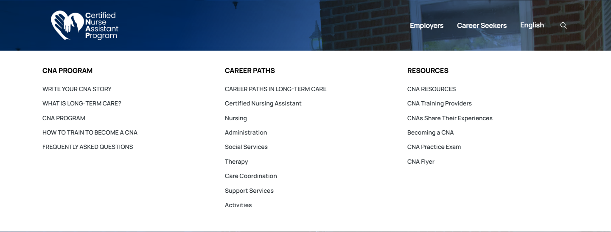
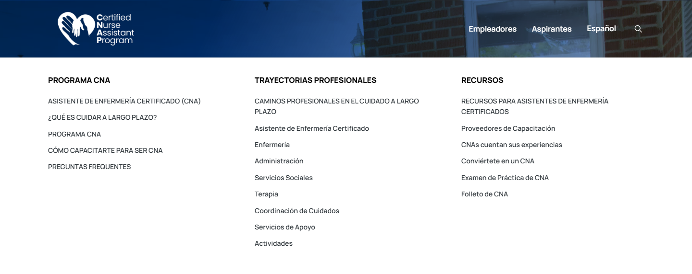

# Add-on 01 — favicon and mega-menu behavior

Status: implemented on addon-01-favicon-menu-og for separate review. Owner approved the reduced plan; social preview images/samples and their approved-design entry are deferred. No phase advancement, merge or production promotion.

## Delivered

D-007/D-008 are approved in design-changes-log.md. App Router icon files/manifest carry over the original live favicon. The desktop menu now has centralized 100ms open/350ms close timing, cancelable timers, immediate switching while a panel is active, and an invisible measured trapezoid bridging the trigger/panel gap. Pointer entry cancels closing, keyboard Enter/Space opens, ArrowDown enters links, Escape closes/returns focus and leaving the group by Tab closes it. Touch first tap opens; tapping outside closes; a second tap retains an enabled top-level destination. Employer destinations remain inactive. Mobile markup/styles are unchanged; no motion animation was added and existing reduced-motion rules remain.

## Icons / source

_source/brand/ was absent. Approved fallback: https://yourcnastory.org/wp-content/uploads/2025/09/cropped-favicon-270x270.png (270×270). Original is served unchanged at that exact upload path, with SHA-256 recorded in content/brand/icons.json. A larger or SVG source would give sharper large icons; the 512px output is upscaled. No vector source was available and no SVG was invented.

| File | Size / purpose |
|---|---|
| app/favicon.ico | Embedded 16/32/48px PNG frames |
| app/icon.png | 32×32 browser icon |
| app/apple-icon.png | 180×180 Apple touch icon |
| public/images/icons/app-icon-192.png | 192×192 manifest icon |
| public/images/icons/app-icon-512.png | 512×512 manifest icon |
| app/manifest.ts | App Router web manifest, display=browser, theme_color=#0159d3 from --blue design token |
| public/wp-content/uploads/2025/09/cropped-favicon-270x270.png | Unmodified 270×270 source retained |

Generation: node scripts/generate-app-icons.mjs. Existing Next-provided Sharp is used; no new package. ICO directory/frame sizes and served PNG/manifest dimensions are independently checked by tests.

## Verification

- lint, typecheck, format:check and production build passed.
- Full Playwright regression: 70 passed, including eight add-on cases, existing mobile navigation, source metadata/copy and all 280 redirects.
- Focused Firefox: six passed/two touch-emulation skips; WebKit: eight passed. Header axe checks return zero violations in both language panels across the three engines.
- Hover tests cover delayed opening, lingering in the bridge past close delay, diagonal entry, immediate switching, brief exit/re-entry and final delayed close. Keyboard tests cover visible focus, expanded/controls, Enter/Space, explicit ArrowDown, Escape return and Tab exit. Touch tests cover first tap/outside tap/second-tap destination with reduced motion.
- Four panel-only published-before/local-after comparisons (two menus × EN/ES) have identical dimensions and zero changed pixels. Evidence: addon-01-menu-appearance.json. This is scoped appearance parity, not whole-site certification.
- Original favicon source SHA-256 preserved; App Router head tags and fetched icon dimensions pass in EN/ES. Hosted verification passed all 48 page heads, six icon/source hashes, manifest contents, EN/ES live-pointer bridge/switching, keyboard, touch and header axe checks. Four preview screenshots and exact tags are attached below. Temporary test access was revoked; normal preview authentication remains enabled.

Background media is isolated in header tests. WebKit DOM-ready/targeted-font readiness avoids waiting for streaming media. Its native Tab behavior follows platform preferences; ArrowDown provides explicit panel entry. Automated WebKit/touch emulation is not native Safari/iOS or physical-device certification. Existing whole-site D-004 accessibility/performance exceptions remain unchanged.

## Social preview images

Deferred at the owner's request. No option A/B/C implementation, six sample renders, OG coverage gate or og:image/twitter:image change is included. Existing titles, descriptions and social metadata remain source-driven.

## Preview / handoff

Separate PR: https://github.com/wallysabria/yourcnastory/pull/9

Verified protected preview: https://yourcnastory-dvyvswgol-wallysabrias-projects.vercel.app

Verified runtime SHA: a09e554b999552b2e7ab1bf4511fd5f5dc7e36b4. Do not merge or publish automatically. Employers remains English-only, content pending and gated. Chatbots remain deferred. Indexing and live integrations stay disabled/mocked.


## Rendered preview head evidence

### /

```html
<link rel="manifest" href="/manifest.webmanifest" />
<link rel="icon" href="/favicon.ico?favicon.3nogywnwp85zd.ico" type="image/x-icon" sizes="48x48" />
<link rel="icon" href="/icon.png?icon.14gyfe6at81g0.png" type="image/png" sizes="32x32" />
<link rel="apple-touch-icon" href="/apple-icon.png?apple-icon.10mv1x-4pijq0.png" type="image/png" sizes="180x180" />
```

### /es/

```html
<link rel="manifest" href="/manifest.webmanifest" />
<link rel="icon" href="/favicon.ico?favicon.3nogywnwp85zd.ico" type="image/x-icon" sizes="48x48" />
<link rel="icon" href="/icon.png?icon.14gyfe6at81g0.png" type="image/png" sizes="32x32" />
<link rel="apple-touch-icon" href="/apple-icon.png?apple-icon.10mv1x-4pijq0.png" type="image/png" sizes="180x180" />
```

Next reports the largest ICO frame as 48×48 in its link tag; independent directory/PNG decoding verifies all three embedded sizes (16/32/48). All icon/manifest links are inherited by both languages and all 48 current pages.

## Preview screenshots





Employer-menu screenshots with destinations inactive: addon-01-preview/menu-employer-en.png and menu-employer-es.png.

The public alias remains unchanged until separately authorized merge/publication.


CI test-readiness note: a source font load can fail on the runner while the browser uses its fallback. The header interaction test waits for that font-load attempt to settle rather than treating a network rejection as a menu failure. It still checks the full timing/bridge behavior and real rendered hit areas; the separate four-panel appearance comparison retains its font-ready method. No production font or menu code was changed for this test adjustment.


## Publication — owner approved 2026-11-08

Owner explicitly requested merge, lint and publish. PR #9 merged as 539578754289eb4e5605dccb8babcdf5f43dfd34 after passing PR checks. Lint/build passed again before merge. Vercel production deployment https://yourcnastory-4ijyg8r8r-wallysabrias-projects.vercel.app is READY and owns https://yourcnastory.vercel.app/. Public verification passed all 48 page icon/title/description/og:image/noindex checks, six icon/source byte hashes, manifest contents and all eight EN/ES add-on tests (hover, keyboard, touch, header axe and icon dimensions). Evidence: addon-01-production-checks.json.

Earlier unmerged/unpublished statements describe the review handoff and are superseded by this authorization. Social preview images remain deferred/unchanged; Employers remains gated and English-only with content pending; chatbots remain deferred. Indexing remains disabled, integrations remain mocked/off and no DNS/custom-domain cutover occurred.
