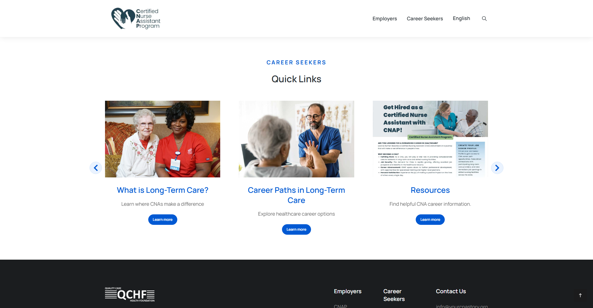

# Shared carousel arrows and subtle circles

The source-style chevrons now cover all native carousel navigation, including Career Seekers, Quick Links, homepage, career-detail and other shared sections in both languages. D-011/D-012 are owner-approved; owner selected pale-blue circles on 2026-11-10. This expands the same unmerged PR #13 and does not advance a phase.

Use the existing self-hosted Font Awesome 5 Free 900 chevrons at 24px, blue #0159d3, in existing 40px controls with a #eaf3ff circular fill and thin #d6e6fa border. Hover uses #dcecff/#bfd8f5. Restore source horizontal/vertical translations; each carousel keeps its own responsive offsets. Visible keyboard-only focus remains. Route-specific background pseudo-element rules are reset so chevrons stay visible, including Quick Links. No shadow, scaling, new animation, font or dependency. Reduced-motion handling remains unchanged.

Only app/content.css changes runtime behavior/presentation. Copy, metadata, destinations, slide order, source layouts and event handlers remain unchanged. Inline link arrows, disclosure icons and back-to-top are distinct contexts and keep their source treatment. Employers destinations remain inactive.

Verification: lint/build/format and all 70 existing regression tests pass. All 48 built pages inspected at 1920px/390px (96 page views); 43 visible carousels on 38 pages, 86 carousel views total, pass checks for circle/color/glyph/font/opacity/display, control dimensions and keyboard focus. Two intentionally hidden breakpoint variants are recorded separately. Mouse/Enter navigation checked wherever additional slides exist. EN/ES Quick Links touch Next/Previous and hover colors verified separately. Some desktop carousels already show every item: their pre-existing no-advance behavior is unchanged. Raw source untouched, no live forms or tracking enabled.

Evidence: shared-carousel-arrows.json, shared-carousel-arrows-hover.json, shared-carousel-arrows-touch.json, shared-carousel-arrows-tests.json and screenshots in shared-carousel-arrows/. Browser checks ran against the local production build. Earlier career-only evidence is retained as the original source comparison; the shared evidence supersedes it for the final styling.

PR: https://github.com/wallysabria/yourcnastory/pull/13

Updated protected preview: https://yourcnastory-j5v6pkkde-wallysabrias-projects.vercel.app/career-seekers/ No merge/publication. Normal preview authentication is retained; no temporary bypass credentials created. Existing Employers/chatbot/indexing/tracking gates remain unchanged.

## Publication — owner approved 2026-11-10

All PR checks passed, then PR #13 merged as d7a40b4e5db6f3a6e3da6b84988b45f917aee016. Production deployment https://yourcnastory-cx5qtdbei-wallysabrias-projects.vercel.app is READY and owns https://yourcnastory.vercel.app/. Public checks passed 20 EN/ES page views at 1920px/390px across homepage, Career Seekers/Quick Links, career detail, FAQs and Earn and Learn: 26 visible carousel views, two intentionally hidden breakpoint variants recorded, blue chevrons/pale-blue circles/dimensions/focus and navigation wherever additional slides exist. All pages return 200/noindex. Evidence: shared-carousel-arrows-production.json and shared-carousel-arrows-production/. Earlier review-stage unpublished notes are superseded. No custom-domain cutover, WordPress edits, integration activation or phase advancement.
