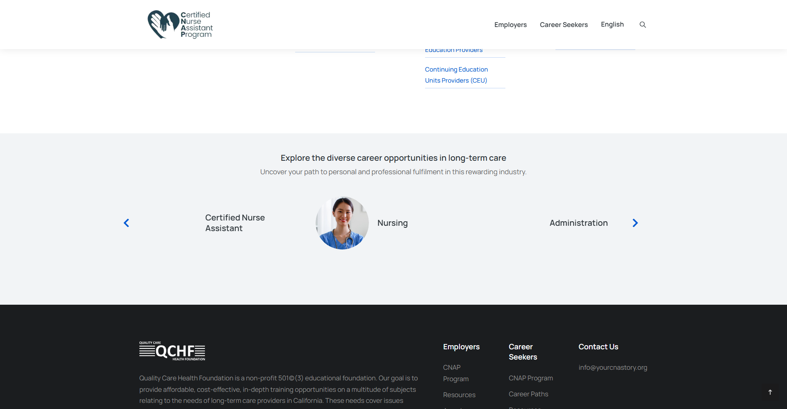

# Career-detail carousel arrows

Owner requested matching source controls (D-011 approved, 2026-11-10). Separate CSS-only correction scoped to careerpath-entry, shared by eight English/eight Spanish career pages. Existing native buttons, accessible labels, handlers, slide order, links, copy, metadata and all other carousels are unchanged.

Public source measured after carousel initialization: Font Awesome 5 Free 900 chevrons f053/f054 at 24px, #0159d3, transparent 40×40px control boxes. Desktop previous offset -62px and mobile 0px; next left 100%, translated -40px. Both controls translate vertically -20px to center on the source row. The rebuild previously used thin gray SVG chevrons and omitted translations. Reuse the already self-hosted source font and existing responsive offsets; no dependency, font download, redesign or image edit. Source background pseudo-element styles are reset for the glyph; visible keyboard-only focus is restored. Red screenshot rectangles are annotations, not borders to reproduce.

Verification: lint/build/format checks; existing 70-test regression passed. Final arrow-specific checks pass 32 views (16 pages × 1920/390): exact source color/font/glyph, 40px boxes, x offsets, persistent glyph opacity, both arrows aligned, mouse Next, Enter Previous and visible keyboard focus. Snapshots are in career-carousel-arrows/; measurements in career-carousel-arrows.json; test stats in career-carousel-arrows-tests.json. These browser checks ran on the local production build. Source inspected publicly with tracking blocked; no WordPress login/forms.

Review PR: https://github.com/wallysabria/yourcnastory/pull/13

Protected preview: https://yourcnastory-9nr8qfixg-wallysabrias-projects.vercel.app/careerpaths/careers-in-certified-nurse-assistant/

Preview authentication is retained; no temporary bypass credentials were created. Browser evidence above is from the local production build.

 No merge/publication or phase advancement. Existing Employers/chatbot/indexing/tracking gates remain unchanged.
