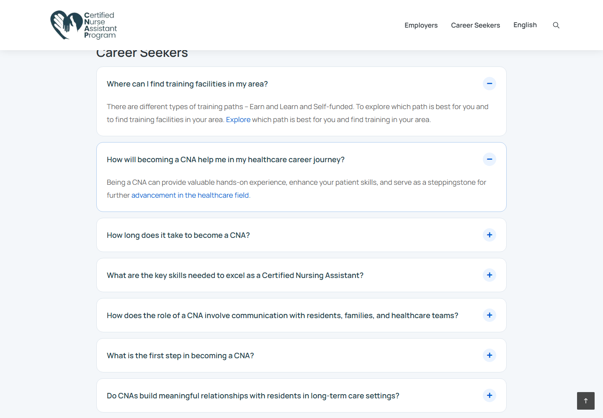

# Career Seekers FAQ cards and working answer reveals

Owner approved a cleaner modern FAQ treatment on 2026-11-10 (D-013). EN/ES Career Seekers FAQs now use separate white cards on #f4f7fa, 16px corners, subtle borders, generous spacing and a readable 1000px section width. Questions are dark semibold, with blue plus/minus icons in 32px pale-blue circles matching the site's carousel controls. Answers remain directly beneath their questions, with comfortable line spacing. Mobile uses smaller padding/type. Keyboard focus stays visible; restrained border-color transitions are disabled for reduced motion. The hero and Quick Links remain in their existing presentation.

The underlying reveal bug is also fixed: Elementor's display:none beat the former open-state display rule despite aria-expanded=true/hidden=false. The open-state override now wins; closed answers remain hidden. Four new regression cases check actual visibility of every answer rather than only aria-expanded.

All styling is scoped to the faq-accordion template (Career Seekers EN/ES); Employers FAQ remains gated. Question/answer copy, links, order, IDs, metadata, native handlers and link styling are unchanged. This extends PR #14; no new phase or dependency.

Verification: lint/build/format pass; all 74 tests pass, including all 11 questions per language at desktop/mobile with click/Enter/Space. Eight EN/ES layout views at 1920/1440/768/390 verify 88 cards, dimensions/colors/type, visible focus, answer open/closed states, reduced-motion transitions and no horizontal overflow. Four normal viewport screenshots: faq-cards/. Evidence: faq-cards.json and faq-cards-tests.json. The earlier faq-answer-visibility artifacts document the reveal-only fix before the approved visual update. All browser evidence is from the local production build. Existing source-style inline-link accessibility exceptions remain per D-004; no unapproved link restyling.

PR: https://github.com/wallysabria/yourcnastory/pull/14

Updated protected preview: https://yourcnastory-9n0h11dul-wallysabrias-projects.vercel.app/frequently-asked-questions/ No merge/publication; no integration/indexing changes. Preview protection is retained and no temporary access credentials were created.
