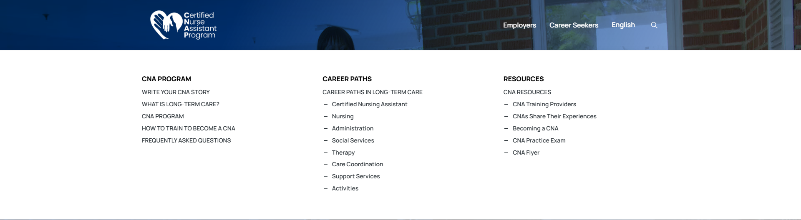

# Mega-menu source markers and spacing

Owner requested matching the source dropdown's dash/bullet markers as closely as possible (D-010 approved in design log).

Shared EN/ES desktop menus now mark the same child links as the live source: eight career roles and five Career Seekers resource links; seven inactive Employer resource children are also styled consistently. Overview/program links remain unmarked. Optional `nested` presentation flags are stored with the navigation data. Decorative empty CSS pseudo-elements draw the source SVG rectangle at its 14px rendered scale; no hyphen or punctuation is added to accessible labels or frozen Spanish copy.

Live source measurements: 14px/600 link text with 28.9px row line-height and no row margins; 16px/900/16px column headings; 14px SVG icon (16×16 viewBox, rectangle x2.7/y7.2/w10.6/h1.7); actual child text starts 22.5px from the row edge (icon + inline space + text padding). Panel vertical padding and column spacing reproduce the screenshot's compact approximately 407px Career Seekers dropdown at 1920px. Source navigation was inspected read-only with tracking blocked; no WordPress login/form submission.

Only global menu presentation/data/schema are changed. Existing hover intent, safe hover bridge, keyboard/touch handlers, mobile markup, links, gating and footer remain unchanged. Both global JSON records deep-compare equal to main after removing only the new presentation flags.

Verification: lint/typecheck/format/build; existing full regression; 12 local menu views (EN/ES × two menus × 1920/1440/1280), marker group counts/indentation and screenshots. All 70 existing tests passed. Protected preview independently passed all 48 page metadata/icon/noindex checks, EN/ES marker counts (13 Career Seekers and 7 inactive Employer resource children), exact 22.5px indentation, hover/keyboard/touch and zero header axe violations. Temporary test access was revoked; normal preview authentication remains enabled. No new dependency or implementation-mirroring test. Existing body accessibility exceptions remain; header axe is exercised by the existing add-on tests.

Screenshots and measurements: menu-markers/ and menu-markers.json. A separate PR/preview is prepared; no merge/publication in this task, and no phase advancement or integration/indexing changes.

## Review preview

PR: https://github.com/wallysabria/yourcnastory/pull/11

Verified protected preview: https://yourcnastory-36tk7n7zd-wallysabrias-projects.vercel.app/career-seekers/

Verified runtime SHA: 2fe0b57f3d62d77175c48f7dce49eff2cc5d4b9e. Documentation-only follow-up commits do not change menu rendering.

Spanish and inactive Employer-menu screenshots are in menu-markers-preview/. Decorative dash areas remain part of enabled link hit areas; source labels and destinations are unchanged. Public alias remains unchanged pending owner-approved merge/publication.

## Publication — owner approved 2026-11-09

PR #11 merged as 2619dd4c5730e34c1bdaf02a67ae8b41b58c8234 after all checks passed. Vercel deployment https://yourcnastory-uzqxl9lg6-wallysabrias-projects.vercel.app is READY and now owns https://yourcnastory.vercel.app/. Public verification passed 12 EN/ES menu views at 1920/1440/1280px: correct child marker counts, 22.5px indentation and clickable decorative dash areas. Original navigation labels/destinations still deep-compare unchanged. /career-seekers/ and /es/aspirantes/ return 200 with noindex and no production tracking scripts. Evidence: menu-markers-production.json and menu-markers-production/. Earlier review-stage unpublished notes are superseded. No custom-domain cutover or phase advancement.
